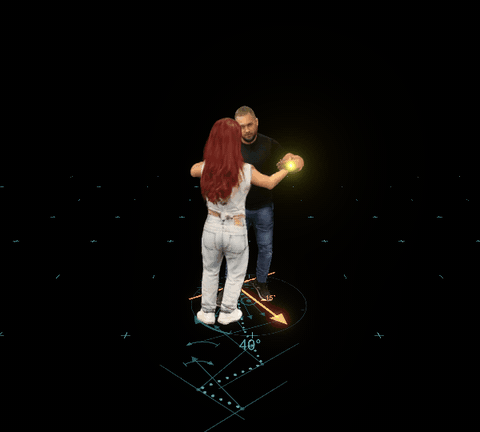
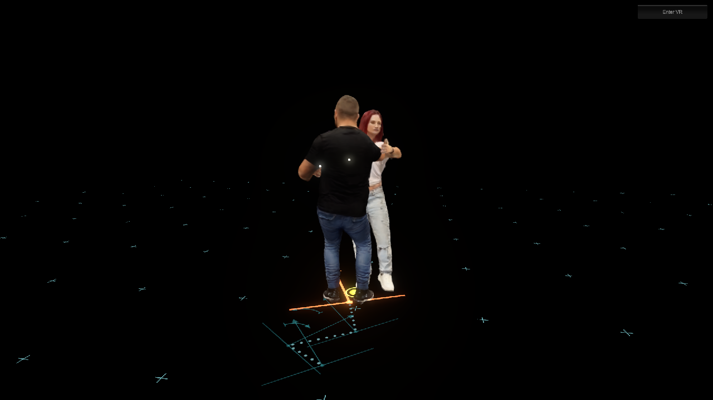
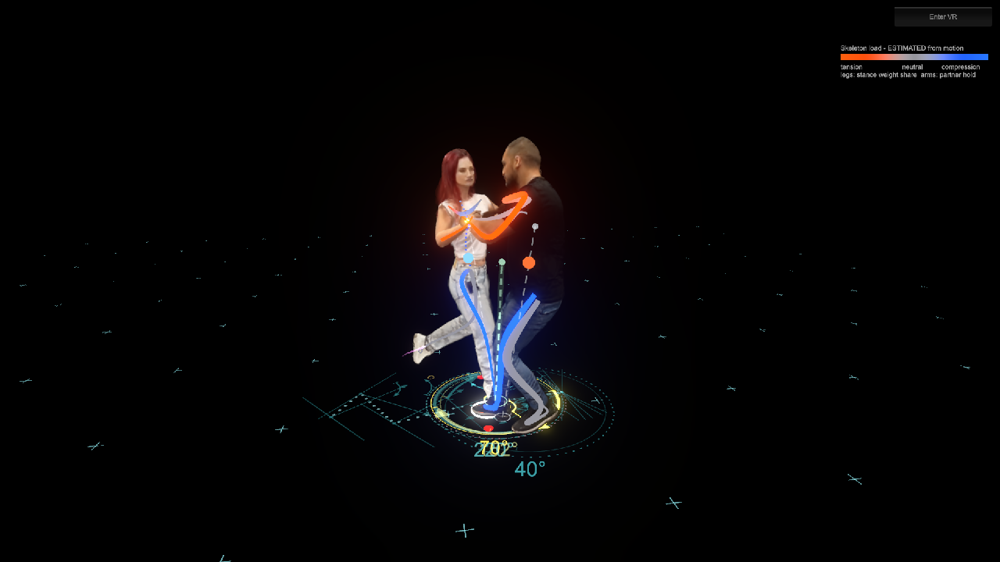
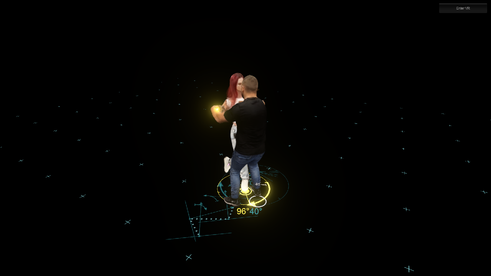
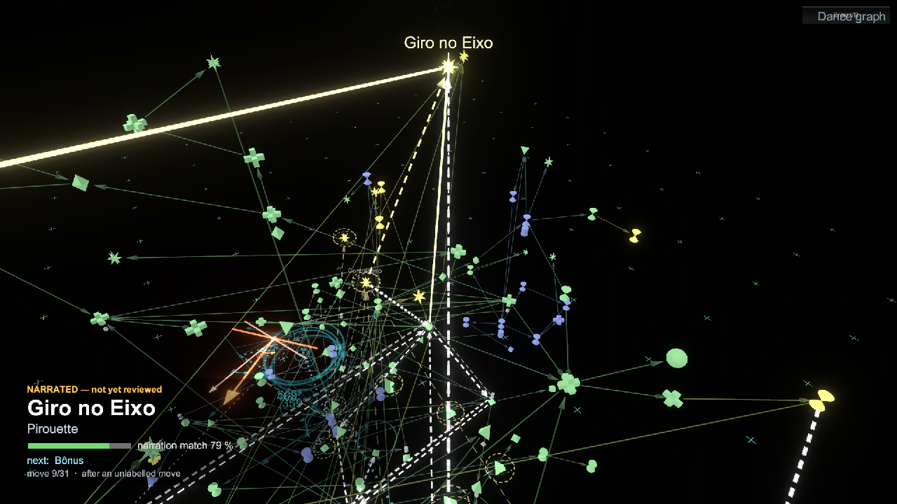
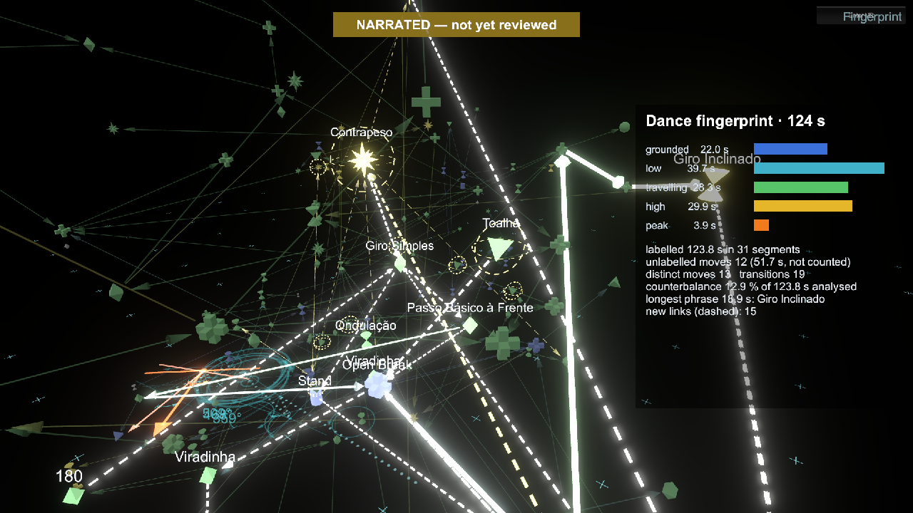

# Head Movement (ZR)



An immersive viewer for partner dance (Brazilian zouk). It plays back captured dances in 3D for teaching: on a desktop, in
rendered video, and on a Meta Quest 3 in passthrough mixed reality, where the couple dances life-size in your room.

The dancers are **LHM++ Gaussian splats** skinned to SMPL-X motion that is reconstructed from ordinary phone videos (the capture
pipeline lives in a separate workspace). A dancer with no splat data is shown as a skeleton. The old mesh avatars are retired and are
never drawn.

## Viewer modes

| Rhythm (default) | Physics (`P`) |
|---|---|
|  |  |
| On every beat a pulse runs from the stance feet up through each body. Its strength follows the beat type and how well each body part's accent lands on the beat. The floor shows no footprints in this mode. | Each limb is coloured by its **estimated** axial load: orange for tension, blue for compression. It also shows the centre of mass and the balance axes, and the footprints come back, coloured by timing against the nearest beat. |

| Counterbalance | Dance graph and fingerprint |
|---|---|
|  |  |
| A pivot appears as a dial on the floor around the anchored foot. It shows the turned angle and the shared centre of mass, with a verdict on how well the couple stayed over the pivot. | The dance's path through a graph of zouk moves, with the current move named and a confidence score. |



The **fingerprint** is a time-independent summary of a dance: how long it dwells in each move and at each level (grounded, low,
travelling, high, peak), plus its transitions and its share of counterbalance.

Other layers:
- floor craft: the leader's T axis, pivots and transitions;
- the follower's neck axis;
- hand-contact lights;
- motion traces;
- a live rhythm-entrainment estimate ([docs/RHYTHM_SCORE.md](docs/RHYTHM_SCORE.md));
- a directed tour (`O`) that moves through orbit, overhead, geometry, physics, dance graph and fingerprint views.

## Keyboard

| Key | Action |
|---|---|
| `1`-`0` | load a dance |
| `Space` | play / pause |
| `,` `.` | step one beat (pauses) |
| `[` `]` | previous / next measure |
| `L` | loop the current measure |
| `R` / `Home` | restart |
| `←` `→` | playback speed (0.5x, 0.75x, 1x) |
| `P` | physics mode (on/off; off = rhythm mode) |
| `F` | floor layer |
| `T` | footprints: recent → all → off (shown in physics mode) |
| `B` | timing overlay |
| `V` | dancers |
| `C` | virtual cameras |
| `G` / `M` | room splats / room mesh |
| `O` | directed tour |
| `H` | HUD |

VR controller: button one play/pause, button two loop measure, up/down previous/next measure, left/right speed. On Quest the
hands work too (pinch, palm menu, snap turn and teleport): see [docs/QUEST.md](docs/QUEST.md).

## Data

Each dance is one folder under `Assets/StreamingAssets/` (git-ignored: it holds likeness data):

```
capture.json              manifest: frame rate, audio offset, the files below
audio.wav                 the music
times.json                the capture timeline
smplx_<role>.bin          SMPL-X motion per dancer (55 joint rotations + positions per frame)
smplx_<role>_skin.bin     the shaped body rig the splats are skinned to (never drawn)
splats/<role>.splatav     LHM++ skinned Gaussian splats per dancer (+ <role>.json; quest_* sets for the headset)
timing.json               footsteps, accents, beat grid
physics.json              centre of mass, ground reaction, estimated limb loads
counterbalance.json       pivot intervals and the shared centre of mass
floorcraft.json           T axes, pivots, transitions
moves/                    dance-move timeline, graph path and fingerprint (optional)
```

Folders are listed alphabetically on the number keys. See [docs/VIEWER_SPEC.md](docs/VIEWER_SPEC.md) for the full contract,
[docs/SPLAT_DANCERS.md](docs/SPLAT_DANCERS.md) for the splat dancers (they need D3D12 in the Editor: start it with
`-force-d3d12`), and [docs/FILM_LIBRARY.md](docs/FILM_LIBRARY.md) for the rendered films.
